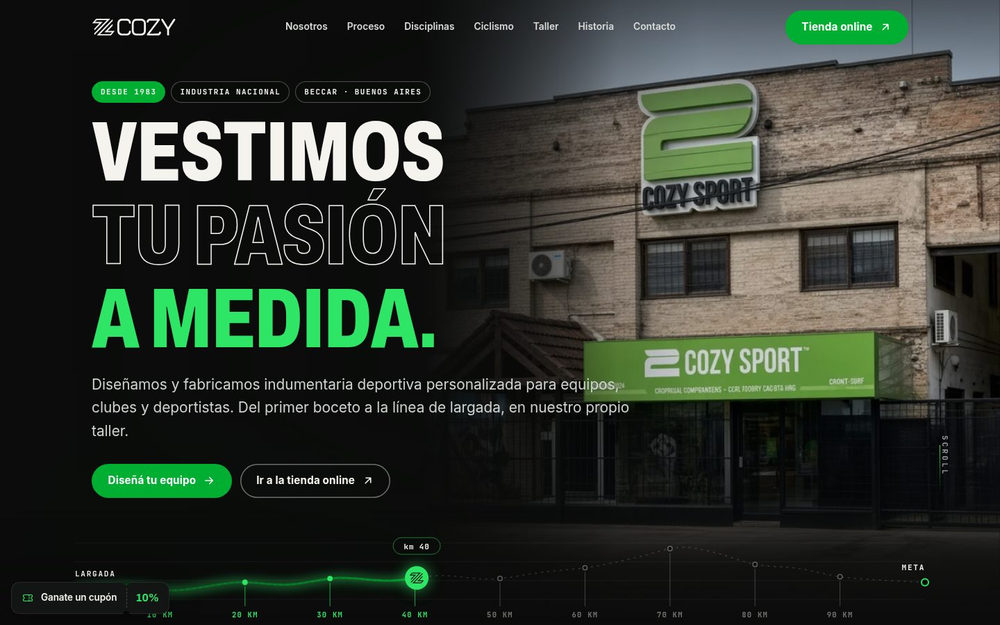
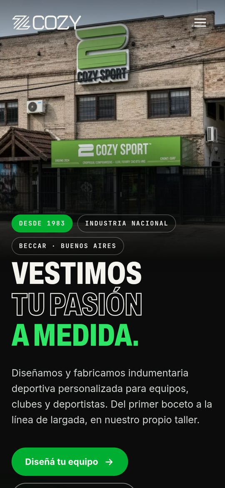
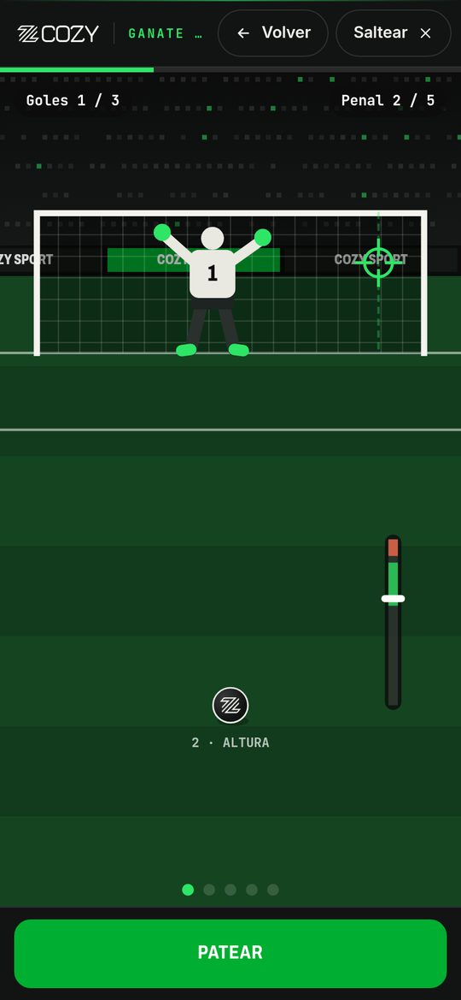
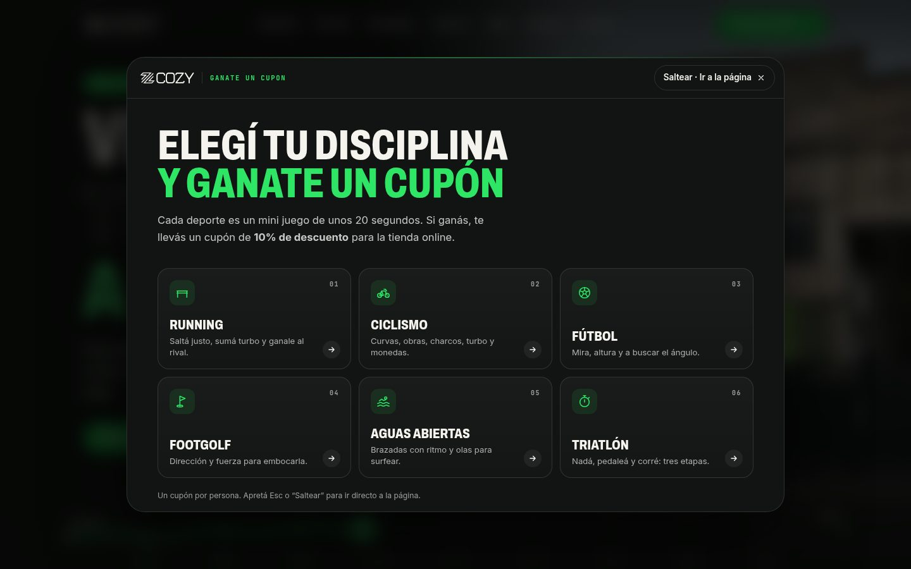

# Cozy Sport · Sitio web

Sitio que diseñé y desarrollé para **Cozy Sport**, la marca de indumentaria deportiva personalizada de Beccar, Buenos Aires, que fabrica para equipos, clubes y deportistas desde 1983.

**Sitio online: [juancjose.github.io/cozy-sport-portfolio10](https://juancjose.github.io/cozy-sport-portfolio10/)**



<p align="center">
  
  &nbsp;&nbsp;
  
</p>

## Qué incluye

**Secciones.** Inicio con la foto de la fachada y una línea de ruta animada de Largada a Meta, Nosotros, Proceso (una ruta que se dibuja con el scroll), Servicios, Disciplinas, Línea Ciclismo con maillots y videos, Taller con las seis etapas de producción, Historia, Tienda online, Preguntas frecuentes y Contacto con mapa y formulario.

**Mini juego "Ganate un cupón".** Al entrar por primera vez se abre una pantalla para elegir un deporte y jugar una partida corta. Si ganás, te llevás un cupón de descuento para la tienda online. Hay seis juegos: Running, Ciclismo, Fútbol, Footgolf, Aguas abiertas y Triatlón. Se juegan con teclado o con controles táctiles, y hay un cupón por dispositivo (queda guardado en el navegador). Se puede saltear con "Saltear" o con Esc, y después queda un botón flotante para volver a jugar o ver el cupón.



**Contacto por WhatsApp con las vendedoras.** El botón "Hablá con nuestras vendedoras" abre una media luna con las asesoras de ventas para elegir con quién hablar. El mensaje de WhatsApp sale armado con los datos del formulario, y el sitio recuerda la última elección. Se puede usar con mouse, con toque o con teclado.

**Responsive y accesible.** Está pensado primero para mobile y probado en 360, 390 y 1440 px. Tiene un link para saltar al contenido, navegación por teclado, textos alternativos y etiquetas ARIA. Si el sistema tiene activado "reducir movimiento", las animaciones (y el temblor de pantalla del juego) se desactivan o se simplifican.

**Rendimiento.** Las fotos están en WebP en tres tamaños (640, 1280 y 1920 px) con `srcset` y carga diferida. CSS y JS llevan un hash de versión (`?v=…`) para que el navegador no mezcle archivos viejos después de un cambio. No uso frameworks ni dependencias en el navegador.

## Tecnologías

- HTML, CSS y JavaScript sin frameworks
- Python para el build y para procesar las imágenes (Pillow)
- GitHub Pages para la publicación

## Estructura

```
index.html            página publicada (se genera con el build, no se edita a mano)
juego.html            copia de la página para mostrar el juego (no se indexa)
src/index.html        plantilla fuente
assets/css/           styles.css (sitio) y juego.css (mini juego)
assets/js/            main.js (sitio) y juego.js (mini juego)
assets/img/           fotos WebP y credits.json con los créditos
tools/build.py        genera index.html y juego.html a partir de src/
tools/images.py       descarga las fotos de Pexels y genera los tamaños WebP
tools/sprite.svg      íconos SVG
variantes/            pruebas que hice para la animación del inicio
docs/                 capturas de este README
```

## Cómo correrlo en local

```bash
python3 tools/build.py          # regenera index.html y juego.html
python3 -m http.server 8000     # y abrir http://localhost:8000
```

Edito `src/index.html`, `assets/css/` y `assets/js/`, y después corro el build. Para sumar o cambiar fotos, las agrego en `assets/img/credits.json` y corro `python3 tools/images.py` (necesita Pillow).

Agregando `?reset-juego` a la URL se borra el cupón guardado y el juego vuelve a aparecer, por ejemplo `http://localhost:8000/?reset-juego`.

## Pendientes antes de la versión final

- Cargar los números reales de WhatsApp de las vendedoras en `VENDEDORES`, al principio de `assets/js/main.js`. Por ahora son números de prueba.
- Cambiar el código del cupón por el real en `CUPON`, al principio de `assets/js/juego.js`. Hoy es `COZY-PRUEBA` con 10 %.

## Créditos

- La foto de la fachada, los videos de la línea de ciclismo, el logo y los textos son de Cozy Sport.
- El resto de las fotos son de [Pexels](https://www.pexels.com) y se usan bajo su licencia. El detalle de cada foto y su autor está en `assets/img/credits.json` y en el pie del sitio. Las fotos del taller son ilustrativas.
- El video de la variante C de `variantes/` es de [Pavel Danilyuk en Pexels](https://www.pexels.com/video/5790258/).

---

juancjose
